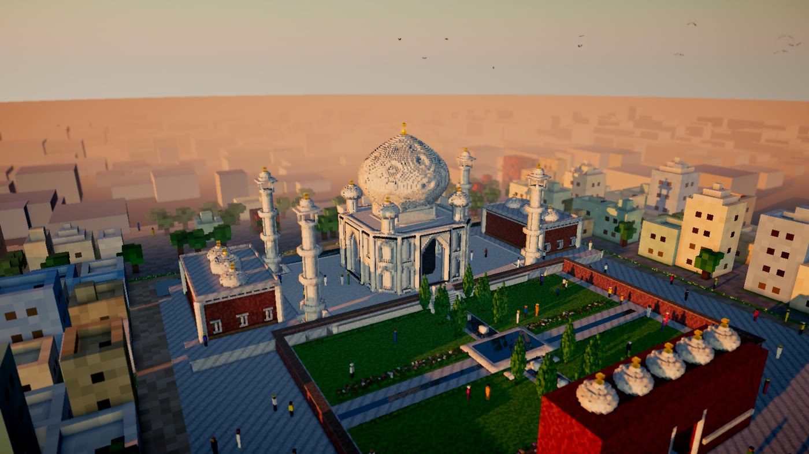

# Walk Me There

Describe a place out loud, in your own language, and walk through it a few minutes later.



*The Taj Mahal, built by the app from a typed description of a visit. You can walk through it on the live site.*

**Demo film:** https://youtu.be/nMwBZWg3quU

**Try it:** https://34-59-251-94.sslip.io has the 15 places from the demo video, and you can build your own by uploading a recording, typing a description or talking live (with daily spending limits). Walking uses a keyboard and mouse, so open it on a computer. The app adapts to slower machines; the film was captured with `?quality=high` added to a place's link, which you can add on a strong GPU.

**Backup:** https://35-196-186-212.nip.io is a second copy on a separate server, in case the main link is down. A place built on one server does not appear on the other.

My grandmother's house in Punjab is gone, and only my mother remembers it, room by room, in Punjabi. Walk Me There turns a spoken memory like hers into a 3D block place I can walk through in the browser. Click the hand pump and you see the words that described it, with a button that plays that stretch of her speech. Every coloured block in a home keeps the words that put it there (the land around it is scenery), and parts of the place nobody described stay grey, labelled as guesses. The small strolling figures and birds are decoration from the viewer, like the scenery, and are not part of the build or its checks.

Plain code checks every build against what was said, and failing checks go back to the builder with the speaker's words. On 8 held-out test homes (typed, spoken-style descriptions with answer keys written separately from the code), this got 92.7% of stated positions right, against 71.7% for the same builder model working alone ([results](docs/results.md)). Six places built from audio uploaded through the app, between 23 and 90 seconds long, in Punjabi, Spanish, Japanese and English, passed 156 of their 170 checks on the first build and 169 of 170 after automatic repairs ([per place](docs/results.md#places-built-from-uploaded-audio)); those checks come from the app's own map of each speaker's words, so they measure the build against that map rather than an outside answer key.

It also works for places you have travelled: describe a visit to the Golden Temple or the Taj Mahal and walk through it as you remember it, with the real place's well-known features filled in, shown muted and labelled as not from your words. The landmark examples were built from typed descriptions.

## What you can do with a place
- **Walk in** through the gate in first person; click any described part to read the words that put it there, and on a recorded place hear them.
- **Play story**: the place builds itself in the order it was described, each part printing up from the ground while that line plays.
- **Fly through**: a cinematic flight computed from the build, over the entrance and in to the main building.
- **Night**: the sun sets, homes glow from inside and gilt and lamps light up; still water mirrors them.
- **Paint this view**: Muse Image paints an impression of the current view as a lifelike scene, shown beside the blocks and labelled as an impression (textures, light and small details are invented).
- **Ask next**: the questions that would make the place more faithful, in English, and for a Punjabi speaker also in Punjabi; a later recording adds to the same place.
- **Minecraft**: download the place and the land around it as a data pack for Java Edition. The hosted places also include a recorded flight through it in the game.

## How it works

```
recording or microphone
   │
   ▼
Muse Voice Transcribe ── timed turns (who spoke, when), Punjabi written phonetically
   │
   ▼
Muse Spark 1.3 ── translates each turn (English, romanized, and the speaker's own script, Gurmukhi for Punjabi), keeping its timestamp
   │
   ▼
Muse Spark 1.3 ── house graph: every room, object, size and position, each tied to the turns that said it;
   │               plus the three questions that would make the house more faithful
   ▼
code ── compiles the graph into checks ("the hand pump is next to the big wooden gate with two leaves")
   │
   ▼
Muse Wonder ── writes a build program against a building kit: rooms with plinths, beams and parapets, open gates,
   │               cots, pumps and stoves, trees by species, and for grand places domes, minarets, arch portals,
   │               pools, causeways, gardens and whole-building parts (a Mughal tomb, a Sikh temple, a Japanese
   │               temple hall, a pagoda); 0.25 m voxels, or 0.5 m for a place too large to fit at that detail
   │
   ▼
locked sandbox ── runs the program in a separate Node process (Node permission model: reads only the server folder,
   │               no network, no file writes, no subprocesses, empty environment so no API key, killed after 20 s)
   │
   ▼
code ── runs every check on the actual blocks; failures go back to Wonder with the words they break,
   │      up to three repairs
   ▼
look and improve ── headless Chrome renders three views; Muse Spark looks at them as an art director;
   │                Muse Wonder rebuilds from the pictures and notes; kept only if no check regresses
   ▼
3D viewer ── walk in through the gate; click a described block to hear or read what was said
```

You can check the checks, because they are code, not a model's opinion:
- **Exists**: everything that was said is built.
- **Position**: "left of", "behind", "inside", "next to", "on top of", in the frame of someone walking in.
- **Size**: within 35% (at least 1 m) of any size that was said.
- **Walkable**: a person-wide route exists from outside to well inside every ground-level room that was described, and the entrance has a person-sized opening.
- **Cited**: every coloured block in the place itself belongs to something that was said, or at a named landmark is marked as a known feature. Guesses must be tagged as guesses and are shown in grey.

### Meta models used
| Model | Role |
|---|---|
| Muse Voice Transcribe (file and realtime) | Timed, speaker-labelled turns from recordings; live sentence-by-sentence turns from the microphone. It worked on my Punjabi recordings even though Punjabi is not one of its evaluated languages (it writes it in Devanagari, which Spark then translates). |
| Muse Spark 1.3 | Translation per turn; the house graph as structured output (strict JSON schema), including recognising a real landmark; the follow-up questions in English, and for a Punjabi speaker also in Punjabi; the art director that looks at renders of each build. |
| Muse Wonder | The builder: writes the build program, repairs it from failed checks, and rebuilds it from pictures of itself and the art notes. |
| Muse Image | "Paint this view": repaints a view of the block house as a lifelike scene, asked to keep the camera, the layout and the materials that were said (it regenerates the whole picture, so this is not guaranteed). Shown beside the blocks and labelled as an impression. |

## Run it

Needs Node 26 or newer (it runs TypeScript directly, and the sandbox relies on its permission model to block network access), ffmpeg, Google Chrome (for the look step's renders), and a Meta Model API key.

```bash
npm install
export MODEL_API_KEY=your-key             # or save the key in ~/.meta_api_key
npm run build                             # builds the web app into web/dist
npm start                                 # http://localhost:8787
```

A place costs about $0.30 to $1.64 in model calls. A fresh clone starts with an empty gallery (built places are stored in `data/`, which is not in the repo), and a place you build stays at its own link. The home page lists only places published with `POST /api/houses/<id>/publish` and the admin token. To try it without a recording, type a description in the box on the home page; to record someone, see [docs/recording-guide.md](docs/recording-guide.md). With no Meta key, `node eval/preview.ts eval/fixtures/kit-example.js demo-kit` builds a sample at http://localhost:8787/h/demo-kit, so you can try walking, Night and the Minecraft export.

Optional settings: `MAX_SPEND_USD` (stops new chat and file transcription calls once the ledger reaches it, default 100; live microphone audio is not counted), `PER_HOUSE_USD` (budget per house, checked between stages, so a build can run slightly over, default 4), `MAX_BUILDS` (visitor builds at once, default 3), `CHROME_PATH` (path to Chrome for the look step, needed on anything but macOS), `GALLERY_ONLY=1` (a copy that only shows places already built), `ADMIN_TOKEN` (turns on the visitor limits; without it, anyone can build with no public limit), `PUBLIC_DAILY_USD` (budget added per day; unspent budget carries over), `PUBLIC_START_DAY` and `VISITOR_DAILY_USD` (limits for a public deployment), `PORT`, `HOST` (a plain local run listens only on this machine, because it has no visitor limits), `LOOK`, `BUILDER_MODEL`, `SPARK_MODEL`, `RENDER_ORIGIN`.

## Measuring it

`eval/run.ts` builds each test description three ways with the same builder model and rules, and measures each build with the same code against answer keys written from the descriptions:
1. house graph, checks and repair (this project),
2. Wonder building straight from the description,
3. Wonder building from the description, then reviewing and fixing its own program once.

On 8 held-out homes, written after the system was tuned:

| | All stated facts (things, sizes and positions) | Positions alone |
|---|---|---|
| House graph, checks and repair | **93.8%** | **92.7%** |
| Wonder alone | 79.3% | 71.7% |
| Wonder with self-review | 77.9% | 69.4% |

Things and sizes alone were 94.8%, 85.7% and 85.0%. It got more facts right than both on all 8 homes, and more positions right on 7 of them (tied on the other), at about four times the cost of Wonder alone ($0.59 a home against $0.15). With the building kit added since, the checked pipeline alone was re-run twice on the same 8 homes: 95.1% and 93.6% with an early version, 96.9% and 96.3% with a later one. Those homes were no longer perfectly unseen by then, as the results explain. Method, caveats and per-home numbers: [docs/results.md](docs/results.md).

## Check it yourself

| Claim | Where |
|---|---|
| Checks are code, not a model's opinion | `server/checks.ts` |
| The checks reject wrong builds, and the sandbox holds | `npm test` (no API key needed) |
| Repair loop with the speaker's words | `server/builder.ts` (`repairNote`) |
| Locked sandbox | `server/sandbox.ts`, `server/sandbox-child.ts`, `server/world.ts` |
| House graph as structured output | `server/graph.ts` |
| Transcription, turn splitting at pauses, translation | `server/listen.ts`, `server/live.ts` |
| Look and improve; Paint this view | `server/review.ts`, `server/paint.ts` |
| Chat and file transcription calls, with cost; Paint records a flat price; live microphone audio is not metered | `server/meta.ts`, `server/paint.ts`, `server/live.ts` |
| Minecraft data pack, with the land around the place | `server/export.ts`; test numbers in [docs/results.md](docs/results.md) |
| Test inputs and answer keys | `eval/heldout/` |
| Test results, per home | `eval/results/heldout1/` (`summary.json`) |
| Results for the recorded places, per build | `eval/results/audio-places.json` |
| Minecraft block comparison | `eval/minecraft-check.py` |
| Rerun the three-way test on the current code (about $10 of model calls; expect different numbers, because the table came from the version before the kit; the baseline arms now use the current building rules) | `EVAL_SET=heldout RUN=heldout1 node eval/run.ts` (writes to `data/eval/heldout1`) |

## Limits
- The 8 test homes are typed, synthetic descriptions, not recordings, so the test measures mapping and building, not speech recognition or translation. Each approach ran once per home.
- The builder's prompt includes a worked example with the same layout as the Punjabi demo house, so that house's first build is not a cold test. It was added after the three-way test on the 8 homes, and it was present for the later kit re-runs and the other places.
- The test runs without the look and improve step, which live talk also skips. Only the checked arm repairs against the checks.
- The walkable check was tightened after the 15 hosted places were built, to require standing well inside each room. Those places keep the results they were built with; under the stricter version, 10 of their rooms would fail, including the grain room in the Punjabi home, whose doorway is blocked by a wall. New builds use the stricter check.
- Recordings have only been tested up to 90 seconds; longer ones may cost more and hit the per-place budget.
- The kit re-run reuses the same 8 homes, so that set is no longer perfectly unseen.
- The checked pipeline costs about four times as much as the builder alone and takes about three and a half times as long.
- Punjabi is not an officially supported Voice Transcribe language; it worked on my recordings. Voice Transcribe returns no word-level timestamps, so clips are per turn.
- Muse Image regenerates the whole picture, so a painting is an impression, not a faithful render.
- Wonder assigns each block's tag, and code confirms the tag is in the map, not that the block looks like the thing it names.
- The entrance check looks along the rows the entrance stands on, so a door drawn swung open can fail it even when you can walk in.
- Compass directions are checked only when the speaker says which way the entrance faces. "Across from" and "opens into" test only distance, and the walkable route can go around the outside of a place to reach a gap in it.
- The checks are deliberately simple: "exists" passes on any block with the right tag, sizes have a 35% tolerance (at least 1 m), and colour is not checked.
- The Minecraft export is tested on Java Edition 26.3 only, and the largest places may need more memory.

## Built during the hackathon

Everything in this repository was written during the Meta Global AI Developer Hackathon (October 27 to November 4, 2026). No earlier code was reused. Libraries: three.js, ws, Vite, puppeteer-core. All colours, ripples, skies and clouds are drawn in code; there are no texture files. The project is not affiliated with Mojang or Minecraft; the Minecraft export writes a plain data pack.

Published as one commit, so the history does not show the build dates; each saved place records when it was built (`createdAt`). Milestones from the working history:

- October 27: first spoken description to a walkable place; evaluation runner and the three-way comparison.
- October 28: real-size landmarks, scenery and the building kit.
- October 30: the six recorded places.
- November 2 and 3: Minecraft export, the public site with uploads and limits, and hardening.

## License

MIT. See [LICENSE](LICENSE).
